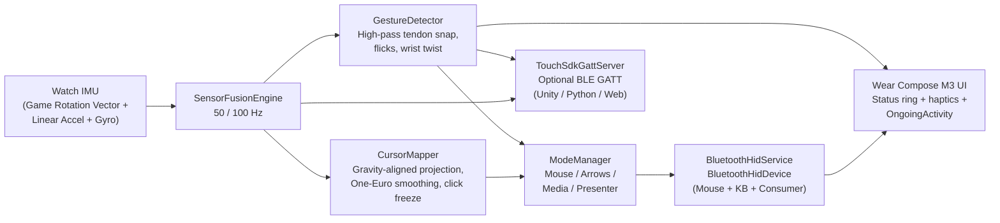

# GestureMouse for Wear OS

A standalone Wear OS smartwatch app (inspired by the discontinued **WowMouse** by Doublepoint) that turns a Wear OS 3 / 4 / 5 watch into a gesture-controlled **Bluetooth HID Mouse, Keyboard, Media Controller, and Presenter**, plus an optional **TouchSDK-style BLE GATT** telemetry streamer for developers.

Move your forearm in the air to glide the cursor, pinch your thumb and index finger to click or drag, flick your wrist to scroll or navigate slides, and twist your forearm to adjust volume — with **no companion app or custom drivers required** on Windows, macOS, Linux, Android, iPadOS, or smart TVs.

---

## Architecture & Data Flow



### Module Breakdown
| Class | Responsibility |
|---|---|
| `sensor/SensorFusionEngine.kt` | Wraps Android `SensorManager` (`TYPE_GAME_ROTATION_VECTOR` + `TYPE_LINEAR_ACCELERATION` + `TYPE_GYROSCOPE` with complementary-filter fallback) and streams platform-independent `ImuSample` frames. |
| `sensor/GestureDetector.kt` | Pure-Kotlin DSP state machine recognizing Single Pinch, Double Pinch, Pinch-Hold (Drag), Palm-Up Pinch, 4-way Flicks (with rebound rejection), and Wrist Twist. |
| `sensor/CursorMapper.kt` | Pure-Kotlin kinematics engine projecting angular velocity onto a gravity-aligned ergonomic horizon with deadzone suppression, non-linear pointer acceleration, adaptive One-Euro smoothing, and click-recoil stabilization. |
| `mode/ModeManager.kt` | Maps `(InputMode, GestureEvent | CursorDelta)` into typed `HidAction`s across Mouse, Arrow Keys, Media Controls, and Presenter modes. |
| `hid/HidDescriptors.kt` | USB-HID 1.11 composite descriptor defining 3 Report IDs: Mouse (5B), Keyboard (8B), and Consumer Control (2B: Media + Brightness). |
| `hid/BluetoothHidService.kt` | Connected-device Foreground Service managing `BluetoothHidDevice`, Wear OS `OngoingActivity`, BT state recovery, auto hardware profile detection, partial wake lock, battery alerts, and thread-safe report dispatch. |
| `hid/TouchSdkGattServer.kt` | Optional BLE GATT peripheral streaming binary gesture events and 30 Hz quaternions for external apps. |
| `data/SettingsRepository.kt` | Jetpack DataStore persistence for thresholds, handedness, watch profile, calibration baseline, and last connected host. |

---

## How the Gesture System Works

### 1. Pinch Detection (Flexor Tendon Snap)
Pinching your thumb and index finger together fires the flexor tendons across the underside of your wrist, creating a brief (~15–40 ms) high-frequency linear acceleration spike concentrated along the watch's dorsal-palmar Z-axis.
- **High-Pass Isolation**: A first-order high-pass filter (`alpha = 0.78`) separates sharp tendon snaps from slow arm translations.
- **Macro-Motion Gyro Gate**: Impulses occurring while overall angular velocity exceeds `75%` of `flickThreshold` are rejected so rapid arm swings do not cause accidental clicks.
- **Palm-Up Context**: When you rotate your palm toward the sky, the watch face points downward (`gravityZ < -0.45`). Pinches in this orientation immediately emit `PalmUpPinch` for reverse/secondary actions (Middle Click, `Esc`, Previous Track/Slide).
- **Single vs. Double vs. Hold**:
  - A second pinch within `340 ms` emits `DoublePinch` (Right Click / Mute / Blackout).
  - Sustained isometric finger micro-tremor following the initial snap transitions to `PinchHoldStart` (latches Left Mouse Button for drag-and-drop) until tension relaxes (`PinchHoldEnd`).
  - Otherwise `SinglePinch` fires cleanly.

### 2. Gravity-Aligned Air Cursor (`CursorMapper`)
- **Roll-Invariant Horizon**: Rather than reading raw watch axes directly, `CursorMapper` projects gyroscope rates onto world-gravity (yaw → horizontal `dx`) and `cross(forearmAxis, gravity)` (pitch → vertical `dy`). Even when your arm rests naturally tilted at 30–45°, horizontal sweeps move the pointer strictly horizontally.
- **Handedness Mirroring**: Switching between `Left Wrist` and `Right Wrist` flips the forearm axis sign (`+1` / `-1`) so vertical aiming, flicks, and wrist twists feel identical on either wrist.
- **Click Stabilization**: When a pinch registers, cursor velocity is damped to `15%` for `90 ms` so mechanical finger recoil does not drag the cursor off tiny buttons.

### 3. Input Modes & Gesture Map

| Gesture | Mouse Mode | Arrow Keys Mode | Media Controls | Presenter Mode |
|---|---|---|---|---|
| **Arm Motion** | Cursor X / Y | Suppressed | Suppressed | Air Laser Cursor |
| **Single Pinch** | Left Click | `Enter` | Play / Pause | Next Slide (`→`) |
| **Double Pinch** | Right Click | `Space` | Mute | Blackout (`B`) |
| **Pinch & Hold** | Drag (Hold Left) | — | — | — |
| **Palm-Up Pinch** | Middle Click | `Esc` / Back | Previous Track | Prev Slide (`←`) |
| **Flick Up / Down** | Scroll Up / Down | `↑` / `↓` | Vol Up / Down | Start (`F5`) / Exit (`Esc`) |
| **Flick Left / Right** | Pan Left / Right | `←` / `→` | Prev / Next Track | Prev / Next Slide |
| **Wrist Twist** | Fine Scroll | List Scrub (`↑`/`↓`) | Fine Volume or Brightness | — |
| **Palm-Up Flick L/R** | Prev / Next Mode | Prev / Next Mode | Prev / Next Mode | Prev / Next Mode |
| **Scroll Clutch** *(2x tap icon or Quick Settings)* | Pitch-to-Scroll | — | — | — |

---

## How Bluetooth HID Pairing Works

GestureMouse uses the official Android **`BluetoothHidDevice`** profile (`BluetoothProfile.HID_DEVICE`, available on Wear OS 3 / API 30+) and registers a composite SDP record (`SUBCLASS1_COMBO`).

### Pairing Steps
1. Open **GestureMouse** on your watch and grant Bluetooth & Notification permissions.
2. Tap **Pair** on the main circular screen and approve the system *"Make watch visible to other devices"* prompt (180 seconds).
3. On your target host:
   - **Windows 10 / 11**: *Settings → Bluetooth & devices → Add device → Bluetooth → GestureMouse*
   - **macOS**: *System Settings → Bluetooth → Connect next to GestureMouse*
   - **Linux (BlueZ)**: `bluetoothctl` → `scan on` → `pair <MAC>` → `trust <MAC>` → `connect <MAC>`
   - **Android / Android TV**: *Settings → Connected devices → Pair new device → GestureMouse*
   - **iPadOS**: *Settings → Bluetooth → GestureMouse* (enable *AssistiveTouch* if cursor does not appear automatically)
4. Once connected, the watch's outer ring turns **emerald green** with a haptic confirmation and remembers your host for one-tap reconnection next time.

---

## Optional TouchSDK-Style BLE GATT Developer Mode

Toggle **TouchSDK BLE** in Quick Settings to stream raw gestures and orientation quaternions over Bluetooth Low Energy alongside (or independent of) Bluetooth HID.

- **Service UUID**: `7B9F0001-4E2A-4D8C-9C1B-A3F100000001`
- **Gesture Notify UUID**: `7B9F0002-4E2A-4D8C-9C1B-A3F100000001`
  - 6-byte little-endian packet: `[eventCode: uint8, extra: int8, timestampMsLow32: uint32]`
  - Codes: `0x01` SinglePinch, `0x02` DoublePinch, `0x03` HoldStart, `0x04` HoldEnd, `0x05` PalmUpPinch, `0x10..0x13` Flick U/D/L/R, `0x20` WristTwist (`extra = deltaDegrees`), `0x30` ModeSwitch (`extra = +1/-1`).
  - Advertises the 128-bit Service UUID in the primary BLE packet and device name in the scan response to stay safely within the 31-byte legacy BLE limit.
- **Orientation Notify UUID**: `7B9F0003-4E2A-4D8C-9C1B-A3F100000001`
  - 16-byte little-endian IEEE-754 float quaternion `[qx, qy, qz, qw]` at ~30 Hz.

### Quick Python Listener (`bleak`)
```python
import asyncio, struct
from bleak import BleakScanner, BleakClient

SERVICE_UUID = "7B9F0001-4E2A-4D8C-9C1B-A3F100000001"
GESTURE_UUID = "7B9F0002-4E2A-4D8C-9C1B-A3F100000001"

async def main():
    device = await BleakScanner.find_device_by_filter(
        lambda d, ad: SERVICE_UUID.lower() in [u.lower() for u in ad.service_uuids]
    )
    async with BleakClient(device) as client:
        await client.start_notify(
            GESTURE_UUID,
            lambda _, data: print("Gesture:", struct.unpack("<BbI", data))
        )
        await asyncio.sleep(60)

asyncio.run(main())
```

---

## Watch Compatibility & Hardware Notes

- **Samsung Galaxy Watch 4 / 5 / 6 / 7 / Ultra**: Full `BluetoothHidDevice` support and crisp 100–200 Hz IMU peaks. Default `GALAXY_WATCH` profile (`pinchThreshold = 3.0`, `smoothing = 0.32`).
- **Google Pixel Watch 2 / 3**: Full `BluetoothHidDevice` support via Qualcomm W5+ co-processor IMU. Slightly softer dorsal impulse peak; `PIXEL_WATCH` profile (`pinchThreshold = 3.5`, `smoothing = 0.38`) or running **Calibrate Pinch** gives ideal click accuracy.

### Known Limitations & Tips
- **Watch Placement**: Wear the band snugly **1–2 cm above the wrist bone**. A loose strap absorbs tendon impulse energy and degrades pinch detection.
- **2.4 GHz Wi-Fi Interference**: Bluetooth Classic HID operates in the 2.4 GHz ISM band. If pointer motion stutters, connect your host PC/Mac to **5 GHz Wi-Fi** or disable Wi-Fi on the watch during sessions.
- **OEM HID Profile Restrictions**: Most modern Wear OS 3/4/5 watches support `BluetoothHidDevice`, though certain regional or older firmware builds can throttle HID interrupt intervals; switching to **50 Hz tracking** in Advanced Settings improves stability on heavily congested links.
- **iOS (iPhone)**: iPadOS supports Bluetooth HID pointers natively; iPhones require *Settings → Accessibility → Touch → AssistiveTouch* to show a mouse cursor.

---

## Building & Testing

### Open in Android Studio
1. Open the `GestureMouse` directory in **Android Studio Ladybug (2024.2+)** or newer with **JDK 17** and **Android SDK 35** installed.
2. Allow Gradle Sync to fetch dependencies from `gradle/libs.versions.toml`.

### Run Unit Tests (No Watch Required)
```bash
./gradlew testDebugUnitTest
```
Includes pure-JVM tests verifying:
- `GestureDetectorTest` — single/double pinch (including high-debounce compatibility), pinch-hold drag, palm-up pinch, hands-free palm-up flick mode switching, gyro arm-swing rejection, flick rebound suppression, right-wrist mirroring, wrist twist, and `flushPending`.
- `CursorMapperTest` — deadzone filtering, gravity-aligned cursor directions on left/right wrists, 45° tilted roll-invariant horizon tracking, click stabilization freeze, scroll clutch.
- `ModeManagerTest` — Mouse, Arrow Keys, Media Controls (Volume + Brightness wrist twist), and Presenter HID mappings + button release safety on forward/backward mode switch.
- `HidDescriptorsTest` — balanced USB-HID collection byte audit, 2-byte Consumer Control brightness bitmasks, and report clamping.

### Testing on Emulator vs. Real Watch
- **Wear OS Emulator**: Ideal for verifying Compose M3 layouts, circular ring animations, onboarding, calibration UI, rotary scroll, and quick settings. Note that the Wear OS emulator does **not** expose a real Bluetooth Classic HID radio or tendon-snap accelerometer impulses; use the **Skip** button on onboarding step 3 and tap the central icon for manual test clicks.
- **Real Watch (Recommended)**: Enable *Developer Options → ADB Debugging* (and Wireless Debugging) on your Galaxy Watch or Pixel Watch, deploy via Android Studio, run **Calibrate Pinch**, and tap **Pair** to control your computer live.
