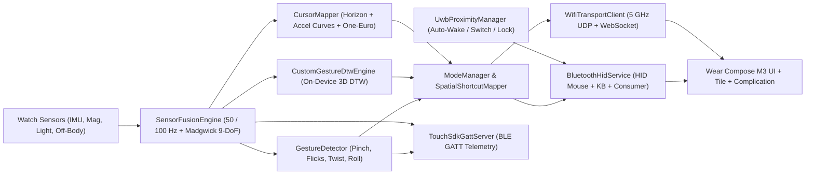

# Continuity Gestures for Wear OS
DISCLAIMER : This was Colab with my local LLM and I.

A standalone **Wear OS 3 / 4 / 5+** smartwatch app that turns your watch into a low-latency, gesture-controlled **Bluetooth HID Mouse, Keyboard, Media Controller, and Presenter**, enhanced with **9-DoF drift-free IMU tracking**, **velocity-based acceleration curves**, **hybrid air-mouse + micro-trackpad aiming**, **3D spatial gestures & custom DTW macros**, **tactile crown & side-button controls**, **dual Bluetooth + 5 GHz Wi-Fi transport**, and an optional **TouchSDK-style BLE GATT** developer stream.

Move your forearm in the air to glide the cursor, pinch your thumb and index finger to click or drag, nudge the last few pixels on the watch glass, spin the crown to scroll pages, or hold the side button to roll timelines and snap desktop windows — with **zero companion software required** in Bluetooth HID mode on Windows, macOS, Linux, Android, iPadOS, and smart TVs.

---

## Table of Contents

1. [Key Features](#key-features)
2. [Architecture & Module Breakdown](#architecture--module-breakdown)
3. [Pointer Mechanics, Sensor Fusion & Gestures](#pointer-mechanics-sensor-fusion--gestures)
4. [Input Modes & Complete Gesture Reference](#input-modes--complete-gesture-reference)
5. [Hardware Controls & Wear OS Surfaces](#hardware-controls--wear-os-surfaces)
6. [Bluetooth HID Pairing Guide](#bluetooth-hid-pairing-guide)
7. [5 GHz Wi-Fi Companion Daemon (Optional)](#5-ghz-wi-fi-companion-daemon-optional)
8. [TouchSDK-Style BLE GATT Developer Mode](#touchsdk-style-ble-gatt-developer-mode)
9. [Settings & Customization Reference](#settings--customization-reference)
10. [Watch Compatibility & Ergonomic Tips](#watch-compatibility--ergonomic-tips)
11. [Building, Testing & Git Hygiene](#building-testing--git-hygiene)

---

## Key Features

### Pointer Mechanics & 9-DoF Sensor Fusion
- **9-DoF Drift-Free IMU (`MadgwickAhrsFilter`)**: Combines 3-axis accelerometer, gyroscope, and magnetometer into a quaternion AHRS filter to cut yaw drift during long sessions (with automatic fallback to `TYPE_GAME_ROTATION_VECTOR` or 6-DoF complementary fusion).
- **Gravity-Aligned Air Cursor (`CursorMapper`)**: Projects angular velocity onto a roll-invariant horizon so horizontal sweeps move strictly horizontally even with a naturally tilted forearm. Supports independent **horizontal/vertical speed scales**, **Invert Y / Invert X**, **Left/Right wrist mirroring**, and **click-recoil freeze**.
- **Velocity-Based Acceleration Curves**: Choose from **Linear 1:1**, **Precision Plateau**, **Balanced S-Curve** (default), or **Dynamic Expo** for pixel-accurate micro-aiming paired with fast edge-to-edge ultrawide flicks.
- **Hybrid Air-Mouse + Micro-Trackpad**: Keep the watch glass active as a relative touch trackpad simultaneously with air-pointing — coarse-aim with your wrist, then slide a finger on screen to nudge the last 10 pixels while air-gyro tremor is damped.
- **Multi-Monitor "Teleport"**: Configure 1–3 displays and tap **D1 / D2 / D3** pills on the main screen (or Quick Settings) to warp the cursor straight to the center of any display.

### Hardware Controls, Spatial Gestures & Smart Sensors
- **Tactile Scroll Wheel & Gen 3 Haptics**: Map the physical rotating crown to **Smooth Scroll**, **Page Up / Down**, **Volume Control**, **Timeline Scrub**, or **Quick Settings**, paired with distinct haptic feedback for left-click, right-click, drag latch, mode switch, and crown detents.
- **Dedicated Side-Button Clutch & Spatial Modifier**: Hold the watch stem button to **Freeze Cursor** (reposition your arm), engage **Precision 0.3x**, or activate **Spatial Modifier**:
  - **Analog Forearm Roll Dial**: Twist your wrist like a doorknob while holding the modifier for continuous **Timeline Scrub**, **Zoom In/Out** (`Ctrl`/`Cmd` + `+/-`), or **Cycle Tabs**.
  - **Modifier + Flick Window Management**: Flick Left/Right/Up/Down while holding the modifier to snap windows, switch spaces, open Task View / Mission Control, or minimize/show desktop (tailored to **Windows/Linux** or **macOS**).
- **Custom 3D Air Gestures (On-Device DTW)**: Record 3 repetitions of any 3D wrist motion in `< 0.5 ms` pure-Kotlin Dynamic Time Warping (`CustomGestureDtwEngine`) and bind up to 6 templates to **Copy**, **Paste**, **Undo**, **Play/Pause**, **Next/Prev Tab**, **Mission Control**, **Lock Screen**, or **Host Macro #1**.
- **Palm-Cover Pause (Ambient Light Sensor)**: Cover the watch face with your other hand to detect a sudden drop in lux (`PalmCoverDetector`) and eyes-free toggle **Pause / Resume** or **Drag Lock**.
- **Wear OS System Gesture Guard**: Guards against Wear OS native **Wrist Turn** (system Back/Dismiss) accidentally closing the app while actively pointing.
- **Off-Body Auto-Pause & Walk-Away Auto-Lock**: Automatically pauses tracking when you remove your watch (`TYPE_LOW_LATENCY_OFFBODY_DETECT`) and optionally fires your host OS Lock Screen shortcut (`Win + L` / `Ctrl + Cmd + Q`) when you walk out of UWB/Bluetooth range.

### Wear OS Native Experience & UI
- **Material 3 Expressive Circular UI**: Edge-safe circular layout keeping the centered neural mouse hub and bottom middle pill anchored while shifting **Play/Pause** and **Settings** upward into the wide circular chord so buttons never clip off curved bezels.
- **5 High-Contrast OLED Neon Themes**: Switch seamlessly between **Neon Green** (default), **Neon Blue**, **Neon Orange**, **Neon Purple**, and **Neon Pink** (plus 2-tap **Reset to Defaults**).
- **1-Nit Stealth Trackpad & Burn-In-Safe Always-On Display**: Drop to a pure-black `#000000` 1 Hz LTPO canvas with invisible left/right click halves and finger micro-trackpad nudging, plus a hollow-stroke burn-in-safe Ambient Mode displaying active/paused mouse status.
- **Wear OS Tile, Watch-Face Complication & Ongoing Activity**:
  - **Continuity Hosts Tile** (`SavedHostsTileService`) for 1-tap reconnection to up to 3 saved hosts.
  - **Quick-Launch Watch-Face Complication** (`QuickLaunchComplicationService`) supporting `SHORT_TEXT`, `MONOCHROMATIC_IMAGE`, and `SMALL_IMAGE`.
  - **Ongoing Activity Chip** on the watch face to jump straight back into an active session.

---

## Architecture & Module Breakdown



### Package & File Structure

| Path | Responsibility |
|---|---|
| `app/src/main/java/com/gesturemouse/wear/MainActivity.kt` | Entry activity handling Bluetooth/notification permissions, physical side-button key interception, screen brightness (`NORMAL` / `DIM_ACTIVE` / `STEALTH_1NIT`), and Wear OS `AmbientModeSupport`. |
| `sensor/SensorFusionEngine.kt` | Streams platform-independent `ImuSample` frames at 50 or 100 Hz (`TYPE_GAME_ROTATION_VECTOR`, `TYPE_LINEAR_ACCELERATION`, `TYPE_GYROSCOPE`, `TYPE_MAGNETIC_FIELD`, `TYPE_LIGHT`, `TYPE_LOW_LATENCY_OFFBODY_DETECT`) with 9-DoF Madgwick fusion and complementary-filter fallback. |
| `sensor/MadgwickAhrsFilter.kt` | Pure-Kotlin 9-DoF Madgwick quaternion AHRS filter reducing yaw drift on long sessions. |
| `sensor/GestureDetector.kt` | Pure-Kotlin DSP state machine recognizing Single Pinch, Double Pinch, Pinch-Hold (Drag), Palm-Up Pinch, 4-way Flicks (with rebound suppression), Wrist Twist, and Palm-Up Mode Switch flicks. |
| `sensor/CursorMapper.kt` | Pure-Kotlin kinematics engine implementing gravity-aligned roll-invariant projection, deadzone filtering, 4 acceleration curves, independent X/Y speed scales, One-Euro smoothing, micro-trackpad tremor damping, click freeze, and Scroll Clutch. |
| `sensor/PalmCoverDetector.kt` | Ambient light sensor sudden-drop detector (lux threshold + hysteresis) for eyes-free Palm-Cover Pause / Drag Lock. |
| `gesture/CustomGestureDtwEngine.kt` | 24-point RMS-normalized 3-axis trajectory resampler + Sakoe-Chiba banded (`±5`) Dynamic Time Warping matcher & serializer. |
| `mode/ModeManager.kt` | Translates `(InputMode, GestureEvent | CursorDelta)` into typed `HidAction`s across Mouse, Arrow Keys, Media Controls, and Presenter modes. |
| `mode/SpatialShortcutMapper.kt` | Maps Analog Forearm Roll steps, Modifier + Flick window shortcuts, Custom DTW actions, and Walk-Away Lock Screen into Windows/Linux or macOS USB-HID reports. |
| `hid/HidDescriptors.kt` | USB-HID 1.11 composite descriptor defining Report IDs `1` (Mouse, 5B), `2` (Keyboard, 8B), and `3` (Consumer Control, 2B: Media + Brightness). |
| `hid/BluetoothHidService.kt` | Connected-device Foreground Service orchestrating `BluetoothHidDevice`, sensor pipeline, crown/side-button events, Wi-Fi transport, UWB proximity, TouchSDK BLE, Wear OS `OngoingActivity`, battery alerts, and saved hosts. |
| `hid/TouchSdkGattServer.kt` | Optional BLE GATT peripheral streaming binary gesture packets and 30 Hz orientation quaternions. |
| `network/WifiTransportClient.kt` | 12-byte XOR-checksummed UDP packet encoder (`WifiProtocolCodec`) + RFC 6455 WebSocket client for Active-App Auto-Profiles, synced host macros, Multi-Monitor Teleport, and Quick Host Handoff. |
| `spatial/UwbProximityManager.kt` | UWB / Bluetooth RSSI proximity state machine (`ProximityHostSwitcher`) for auto-wake, multi-host auto-switch, and walk-away auto-lock. |
| `feedback/HapticFeedbackManager.kt` | Gen 3 Wear OS `VibrationEffect` waveforms for distinct left-click, right-click, drag latch, mode switch, crown detents, and alerts. |
| `data/SettingsRepository.kt` | Jetpack DataStore Preferences persistence for all settings, calibration baseline, saved hosts, custom DTW templates, theme color, and Reset to Defaults. |
| `tile/SavedHostsTileService.kt` | Wear OS ProtoLayout Tile (`Continuity Hosts`) for 1-tap host reconnection. |
| `complication/QuickLaunchComplicationService.kt` | Watch-face complication data source (`SHORT_TEXT`, `MONOCHROMATIC_IMAGE`, `SMALL_IMAGE`). |
| `ui/GestureMouseViewModel.kt` | Reactive state coordinator bridging `BluetoothHidService` and `SettingsRepository` to Compose UI. |
| `ui/screens/*.kt` | `MainScreen`, `QuickSettingsScreen`, `AdvancedSettingsScreen`, `CustomGestureScreen`, `CalibrationScreen`, `OnboardingScreen`, and `TipsScreen`. |
| `ui/components/SettingsComponents.kt` | Skippable primitive-parameter Wear Compose M3 list components (`TransformingLazyColumn` + `SurfaceTransformation`) tuned for 60–120 Hz rotary & touch scrolling. |
| `ui/theme/Theme.kt` | 5-color high-contrast OLED neon palette (`GestureColors` + `LocalGestureAccent`). |
| `companion/gesturemouse_daemon.py` | Optional cross-platform Python reference companion server for 5 GHz Wi-Fi UDP input, Multi-Monitor Teleport, Active-App Auto-Profiles, and Clipboard/URL Handoff. |

---

## Pointer Mechanics, Sensor Fusion & Gestures

### 1. Pinch Detection (Flexor Tendon Snap)
Pinching your thumb and index finger fires the wrist flexor tendons, generating a brief (~15–40 ms) dorsal-palmar linear acceleration spike.
- **High-Pass Isolation**: First-order high-pass filter (`alpha = 0.78`) separates sharp tendon snaps from arm translations.
- **Macro-Motion Gyro Gate**: Rejects impulses when angular speed exceeds `75%` of `flickThreshold` so fast arm swings do not cause false clicks.
- **Palm-Up Context**: Rotating your palm skyward (`gravityZ < -0.45`) emits `PalmUpPinch` for secondary/reverse actions.
- **Single vs. Double vs. Pinch-Hold**:
  - A second pinch within `340 ms` emits `DoublePinch`.
  - Sustained isometric tendon micro-tremor transitions to `PinchHoldStart` (latches Left Mouse Button for drag-and-drop) until relaxed (`PinchHoldEnd`).
  - Otherwise `SinglePinch` fires cleanly.

### 2. Gravity-Aligned Cursor & Acceleration Curves
- **Roll-Invariant Horizon**: Projects gyroscope rates onto world-gravity (yaw → horizontal `dx`) and `cross(forearmAxis, gravity)` (pitch → vertical `dy`), mirrored cleanly for `Left Wrist` (`+1`) vs. `Right Wrist` (`-1`).
- **Four Velocity Curves**:
  - `LINEAR`: Constant 1:1 speed.
  - `PRECISION`: Ultra-slow micro-aim plateau with gentle high-speed ramp.
  - `BALANCED` *(default)*: Linear micro-aiming with smooth exponential fast-flick boost.
  - `DYNAMIC_EXPONENTIAL`: Aggressive boost for sweeping across dual/triple ultrawide displays.
- **Click Stabilization & Hybrid Micro-Trackpad**: Damps pointer velocity to `15%` for `90 ms` during a pinch to prevent click jitter, and damps air-gyro motion briefly whenever your finger slides across the watch glass.

### 3. On-Device Custom 3D Gestures (DTW)
- Resamples arbitrary-length 3-axis gyroscope recordings into **24 evenly spaced points** and normalizes RMS energy to `1.0` so matching is invariant to speed and moderate amplitude differences.
- Uses **Sakoe-Chiba banded (`±5`) Dynamic Time Warping** across up to 6 saved user templates in `< 0.5 ms` per evaluation with zero external ML dependencies.

---

## Input Modes & Complete Gesture Reference

### Standard Modes

| Gesture | Mouse Mode | Arrow Keys Mode | Media Controls | Presenter Mode |
|---|---|---|---|---|
| **Arm Motion** | Cursor X / Y | Suppressed | Suppressed | Air Laser Cursor |
| **Finger Slide on Glass** | Micro-Trackpad Nudge | — | — | Micro-Trackpad Nudge |
| **Single Pinch** | Left Click | `Enter` | Play / Pause | Next Slide (`→`) |
| **Double Pinch** | Right Click | `Space` | Mute | Blackout (`B`) |
| **Pinch & Hold** | Drag (Hold Left) | — | — | — |
| **Palm-Up Pinch** | Middle Click | `Esc` / Back | Previous Track | Prev Slide (`←`) |
| **Flick Up / Down** | Scroll Up / Down | `↑` / `↓` | Vol Up / Down | Start (`F5`) / Exit (`Esc`) |
| **Flick Left / Right** | Pan Left / Right | `←` / `→` | Prev / Next Track | Prev / Next Slide |
| **Wrist Twist** | Fine Scroll | List Scrub (`↑` / `↓`) | Fine Volume or Brightness | — |
| **Palm-Up Flick L / R** | Prev / Next Mode | Prev / Next Mode | Prev / Next Mode | Prev / Next Mode |
| **Scroll Clutch** *(2× tap center hub)* | Pitch-to-Scroll | — | — | — |

### Spatial Modifier Shortcuts (Hold Side Button + Motion)

| Motion | Windows / Linux | macOS |
|---|---|---|
| **Modifier + Flick Left** | Snap Window Left (`Win + ←`) | Previous Space (`Ctrl + ←`) |
| **Modifier + Flick Right** | Snap Window Right (`Win + →`) | Next Space (`Ctrl + →`) |
| **Modifier + Flick Up** | Task View (`Win + Tab`) | Mission Control (`Ctrl + ↑`) |
| **Modifier + Flick Down** | Show Desktop (`Win + D`) | Minimize Window (`Cmd + M`) |
| **Modifier + Forearm Roll** | Timeline Scrub / Zoom (`Ctrl + +/-`) / Cycle Tabs (`Ctrl + [Shift +] Tab`) | Timeline Scrub / Zoom (`Cmd + +/-`) / Cycle Tabs (`Ctrl + [Shift +] Tab`) |
| **Lock Host Screen / Walk-Away Lock** | `Win + L` | `Ctrl + Cmd + Q` |

---

## Hardware Controls & Wear OS Surfaces

### Main Screen Controls
- **Center Neural Mouse Hub**: Tap for Left Click (or Pair when disconnected / Resume when paused); **Double-tap** in Mouse mode to toggle **Scroll Clutch**; **Long-press** to open Quick Settings.
- **Left Circular Button** *(shifted upward for bezel clearance)*: **Play / Pause** when connected, or **Reconnect** last device when disconnected.
- **Right Circular Button** *(shifted upward for bezel clearance)*: **Quick Settings** (tap) or **Disconnect** (long-press when connected).
- **Bottom Center Pill**: **Mode cycle** / synced **Host Macro** when connected, or **Pair** / **Grant BT** when disconnected.
- **D1 / D2 / D3 Micro-Pills** *(shown when Monitors > 1 & active)*: Instant Multi-Monitor Teleport.

### Watch Hardware & Surfaces
- **Rotating Crown**: Configurable between Smooth Scroll, Page Up/Down, Volume Control, Timeline Scrub, or Quick Settings. Also scrolls all Settings & Tips lists with haptic detents.
- **Side Stem Button**: Configurable between Freeze + Spatial, Precision 0.3x, Spatial Modifier, or Off.
- **Ambient Light Sensor**: Cover watch face with palm to toggle Pause/Resume or Drag Lock.
- **1-Nit Stealth Trackpad**: Auto-engages after 3.5 s when enabled — pure `#000000` 1 Hz screen split into invisible Left-Click | Right-Click halves with simultaneous finger-slide nudging (double-tap to wake, long-press for Quick Settings).
- **Always-On Display (Ambient Mode)**: Burn-in-safe hollow-stroke Continuity Mouse icon (showing active wave arcs or paused `||` bars) with periodic pixel shifting.
- **Tile & Complication**: Add **Continuity Hosts** in your watch Tile carousel or **Continuity Gestures** to any watch face slot.

---

## Bluetooth HID Pairing Guide

Continuity Gestures uses Android's standard **`BluetoothHidDevice`** profile (`BluetoothProfile.HID_DEVICE`, Wear OS 3 / API 30+) with a composite `SUBCLASS1_COMBO` SDP record named **`Continuity Gestures`**.

1. Open **Continuity Gestures** on your watch and grant **Bluetooth** & **Notification** permissions.
2. Tap **Pair** on the main screen and approve the system *"Make watch visible to other devices"* prompt (180 seconds).
3. On your computer, tablet, phone, or TV:
   - **Windows 10 / 11**: *Settings → Bluetooth & devices → Add device → Bluetooth → Continuity Gestures*
   - **macOS**: *System Settings → Bluetooth → Connect next to Continuity Gestures*
   - **Linux (BlueZ)**: `bluetoothctl` → `scan on` → `pair <MAC>` → `trust <MAC>` → `connect <MAC>`
   - **Android / Android TV**: *Settings → Connected devices → Pair new device → Continuity Gestures*
   - **iPadOS / iOS**: *Settings → Bluetooth → Continuity Gestures* (enable *Accessibility → Touch → AssistiveTouch* on iPhone if no pointer appears)
4. Once connected, the watch's bezel ring lights up in your selected neon theme with haptic confirmation, and the host is saved for 1-tap reconnection from the main screen and Tile.

---

## 5 GHz Wi-Fi Companion Daemon (Optional)

Bluetooth HID requires **no host software**. If you also want high-rate 5 GHz Wi-Fi UDP input, instant Multi-Monitor Teleport, Active-App Auto-Profiles, live app macros, or Clipboard/URL Handoff, run the bundled Python reference server on your Mac, Windows, or Linux host:

```bash
pip install pyautogui pyperclip websockets
python3 companion/gesturemouse_daemon.py
```

### Protocol Summary
- **UDP Binary Stream** (default port `5959`): Fixed 12-byte little-endian packets:
  `['G', 'M', seq: uint16, type: uint8, p0..p4: 5 bytes, xorChecksum: uint8]`
  - `type = 1`: Mouse move/scroll/pan or click (`p0 & 0x80` click flag)
  - `type = 2`: Key tap (`p0 = modifiers`, `p1 = HID keycode`)
  - `type = 3`: Consumer Control tap (`p0:p1 = 16-bit mask`)
  - `type = 4`: Macro trigger
  - `type = 5`: Multi-Monitor Teleport (`p0 = monitorIndex 1..3`, `p1 = monitorCount 1..3`)
- **WebSocket Control Channel** (UDP port + 1, default `5960`): Two-way JSON messages for:
  - Host → Watch `profile`: pushes focused app name, category, recommended `crown` action, `mode`, and up to several 1-tap `macros`.
  - Watch ↔ Host `handoff_pull` / `handoff_push` / `handoff`: syncs URLs and clipboard text between watch and computer.

Set **Transport Mode** to **5 GHz Wi-Fi** or **Dual BT + Wi-Fi** in Quick Settings and select your host IP under **Advanced → Wi-Fi Receiver IP**.

---

## TouchSDK-Style BLE GATT Developer Mode

Toggle **TouchSDK BLE** in Quick Settings to stream raw gesture events and orientation quaternions over Bluetooth Low Energy alongside (or independent of) Bluetooth HID.

- **Service UUID**: `7B9F0001-4E2A-4D8C-9C1B-A3F100000001`
- **Gesture Notify UUID**: `7B9F0002-4E2A-4D8C-9C1B-A3F100000001`
  - 6-byte little-endian packet: `[eventCode: uint8, extra: int8, timestampMsLow32: uint32]`
  - Codes: `0x01` SinglePinch, `0x02` DoublePinch, `0x03` HoldStart, `0x04` HoldEnd, `0x05` PalmUpPinch, `0x10..0x13` Flick U/D/L/R, `0x20` WristTwist (`extra = deltaDegrees`), `0x30` ModeSwitch (`extra = +1/-1`).
- **Orientation Notify UUID**: `7B9F0003-4E2A-4D8C-9C1B-A3F100000001`
  - 16-byte little-endian IEEE-754 float quaternion `[qx, qy, qz, qw]` at ~30 Hz.

### Quick Python Listener (`bleak`)
```python
import asyncio, struct
from bleak import BleakScanner, BleakClient

SERVICE_UUID = "7B9F0001-4E2A-4D8C-9C1B-A3F100000001"
GESTURE_UUID = "7B9F0002-4E2A-4D8C-9C1B-A3F100000001"

async def main():
    device = await BleakScanner.find_device_by_filter(
        lambda d, ad: SERVICE_UUID.lower() in [u.lower() for u in ad.service_uuids]
    )
    async with BleakClient(device) as client:
        await client.start_notify(
            GESTURE_UUID,
            lambda _, data: print("Gesture:", struct.unpack("<BbI", data))
        )
        await asyncio.sleep(60)

asyncio.run(main())
```

---

## Settings & Customization Reference

### Quick Settings
- **Live Context Cards**: Low Battery 1-Nit shortcut, 1-tap Reconnect, Active-App Auto-Profile banner, Host Macros, Monitor Teleport (`D1..D3`), and Host Handoff & Lock (`Pull/Push Clip`, `Lock Host Screen`).
- **Input & Aiming**: Input Mode (`Mouse` / `Arrow Keys` / `Media Controls` / `Presenter`), Scroll Clutch, Cursor Speed (`0.4x–5.0x`), Micro-Trackpad, Wrist Handedness (`Left` / `Right`), Invert Up/Down.
- **Hardware Controls**: Crown Wheel action, Side-Button Clutch action, Palm-Cover Sensor action, Custom 3D Gestures recorder.
- **Theme, Display & Transport**: Theme Color (5 neon themes), 1-Nit Stealth Pad, Dim While Active, Transport Mode (`Bluetooth HID` / `5 GHz Wi-Fi` / `Dual BT + Wi-Fi`).
- **Preferences**: Wrist Twist Media target (`Volume` / `Brightness`), Gen 3 Haptics, TouchSDK BLE, Advanced Settings, Placement & Tips, 2-tap **Reset to Defaults**, and Disconnect.

### Advanced Settings (Curves, Spatial & Security)
- **Calibration**: Interactive 3-step live **Calibrate Pinch** wizard measuring your resting noise floor and 3 natural pinches.
- **Pointer & Monitors**: Acceleration Curve (`Linear`, `Precision`, `Balanced`, `Dynamic Expo`), Monitor Count (`1–3`).
- **3D Spatial Gestures**: Analog Roll Dial action, Host OS Shortcuts (`Windows/Linux` vs `macOS`), Window Mgmt Flicks toggle.
- **Automation & Security**: Active-App Profiles, Off-Body Auto-Pause, Walk-Away Auto-Lock.
- **Sensor Fusion & Connectivity**: 9-DoF Drift-Free IMU (Madgwick vs 6-DoF), System Gesture Guard, UWB Proximity Switch, Wi-Fi Receiver IP presets.
- **Cursor Axis & DSP Tuning**: Invert Y / Invert X, Horizontal Speed (`0.5x–2.5x`), Vertical Speed (`0.5x–2.5x`), Accel Boost (`0.0x–2.5x`), Cursor Smoothing (`0–85%`), Pinch Threshold (`1.5–7.5`), Flick Threshold (`2.2–8.0`), Debounce (`100–500 ms`), 100 Hz vs 50 Hz sampling, Gesture Mode Switch toggle, Watch Sensor Profile (`Auto`, `Galaxy Watch 4–Ultra`, `Pixel Watch 2–5`), Theme Color, Replay Tutorial, and 2-tap **Reset All Settings**.

---

## Watch Compatibility & Ergonomic Tips

- **Google Pixel Watch 2 / 3 / 4 / 5**: Full `BluetoothHidDevice`, tactile crown wheel, Gen 3 haptics, and optional UWB ranging on supported hardware. Uses `PIXEL_WATCH` profile (`pinchThreshold = 3.4`, `smoothing = 0.36`).
- **Samsung Galaxy Watch 4 / 5 / 6 / 7 / Ultra**: Full `BluetoothHidDevice` and sharp 100–200 Hz Bosch/STMicro IMU peaks. Uses `GALAXY_WATCH` profile (`pinchThreshold = 3.0`, `smoothing = 0.32`).

### Best Practices
- **Strap Fit**: Wear the watch snugly **1–2 cm above the wrist bone** so flexor tendon impulses transmit crisply into the IMU, then run **Calibrate Pinch**.
- **2.4 GHz Interference**: Bluetooth Classic HID uses the 2.4 GHz band. If pointer motion stutters in crowded RF environments, move your host to **5 GHz Wi-Fi** or switch to **50 Hz tracking** (or **5 GHz Wi-Fi transport**).
- **Package ID**: Gradle project and app name are **Continuity Gestures** while keeping `applicationId = "com.gesturemouse.wear"` (`.debug` for debug builds) so upgrades preserve existing DataStore preferences and pairings.

---

## Building, Testing & Git Hygiene

### Prerequisites
- **Android Studio** (Meerkat / Ladybug or newer)
- **JDK 21** for Gradle Daemon (auto-provisioned via `gradle/gradle-daemon-jvm.properties` & Foojay toolchain resolver; bytecode targets **Java 17**)
- **Gradle 8.13** (included via `./gradlew`), **AGP 8.13.2**, **Kotlin 2.1.0**, **Android SDK 35** (`minSdk = 30`, `compileSdk = 35`, `targetSdk = 35`)

### Build Debug & Release APKs
```bash
# Build debug APK (installable alongside release via .debug suffix)
./gradlew :app:assembleDebug

# Build minified & resource-shrunk release APK
./gradlew :app:assembleRelease
```

### Run the Full Unit Test Suite (49 Pure-JVM Tests — No Watch Needed)
```bash
./gradlew :app:testDebugUnitTest
```

| Test Suite | Coverage |
|---|---|
| `CursorMapperTest` | Deadzone filtering, gravity-aligned left/right wrist directions, 45° roll-invariant horizon, 4 acceleration curves, independent X/Y speeds, Invert Y/X, micro-trackpad tremor damping, click freeze, and Scroll Clutch. |
| `GestureDetectorTest` | Single/double pinch (including high debounce), pinch-hold drag, palm-up pinch, hands-free palm-up flick mode switching, gyro swing rejection, flick rebound suppression, right-wrist mirroring, wrist twist, and `flushPending`. |
| `CustomGestureDtwTest` | 24-point RMS resampling, template building from 3 samples, DTW match accuracy & rejection of unrelated motions, and compact string round-trip serialization. |
| `MadgwickAhrsFilterTest` | 9-DoF quaternion normalization, gravity alignment convergence, yaw integration, and reset stability. |
| `PalmCoverDetectorTest` | Lux drop detection, hysteresis recovery, and ambient noise rejection. |
| `ModeManagerTest` | Mouse, Arrow Keys, Media Controls (Volume + Brightness), Presenter mappings, and held-button release safety on mode switch. |
| `SpatialShortcutAndSecurityTest` | Analog forearm roll dial, Windows/Linux & macOS window management flicks, custom gesture HID bindings, and Walk-Away Auto-Lock shortcuts. |
| `WifiAndUwbTest` | 12-byte UDP packet encoding + XOR checksum, Multi-Monitor Teleport packets, WebSocket JSON profile/macro/handoff parsing, and UWB proximity auto-wake / host switch / walk-away lock state machine. |
| `HidDescriptorsTest` | Balanced USB-HID collection byte audit, 2-byte Consumer Control bitmasks, and report clamping. |

### Emulator vs. Real Watch Testing
- **Wear OS Emulator**: Great for verifying Material 3 layouts, circular edge spacing, 5 neon themes, rotary scrolling, onboarding, calibration UI, and ambient/stealth modes. Real Bluetooth Classic HID radio and tendon-snap IMU impulses are not simulated on the emulator — use **Skip** on onboarding step 3 and tap the center hub to test clicks.
- **Real Watch (Recommended)**: Enable *Developer Options → ADB Debugging* (and Wireless Debugging), deploy from Android Studio, run **Calibrate Pinch**, and tap **Pair**.

### Git Hygiene
`.gitignore` excludes all local build artifacts (`.gradle/`, `build/`, `app/build/`, `local.properties`, `.idea/` user state, `*.apk`, `*.aab`) so you can push clean source code to GitHub and rebuild reproducibly on any machine via `./gradlew`.
